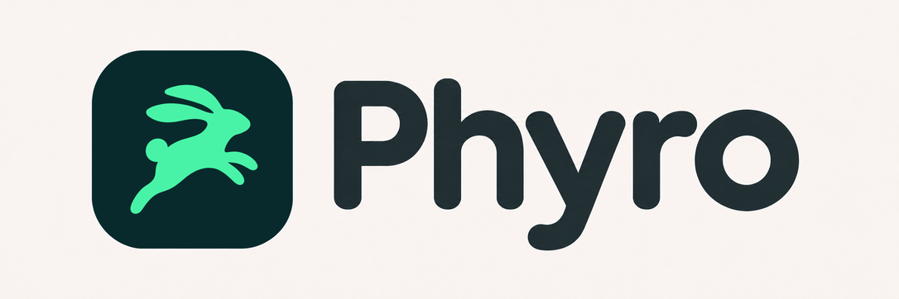
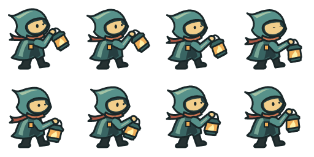

# 

Phyro is a desktop vector drawing and 2D animation editor for game artists. You can animate a character with keyframes, draw effects over it frame by frame, and export the result as a sprite sheet.

I started Phyro to give myself a better way to draw and animate art for my own games. I’m still improving it as I use it, and I welcome suggestions about what could make it more useful in your workflow. [Share feedback on GitHub](https://github.com/savicode-23/phyro/issues)

**[Getting started with Phyro](docs/getting-started.md)** walks you through drawing a ball, animating it with three keyframes, and exporting a sprite sheet. The [editor guide](docs/editor-guide.md) covers drawing tools, layers, morphing and character rigs.

## Download Phyro

**[Download Phyro from GitHub Releases](https://github.com/savicode-23/phyro/releases)**. Open the version you want and expand **Assets**. Download the archive for your computer and extract it before starting the editor.

| Your computer | Phyro archive under Assets | Start the editor |
| --- | --- | --- |
| Windows x64 | `Phyro-<version>-windows-x64.zip` | Open the extracted folder and double-click `phyro.exe`. |
| Ubuntu 24.04 x64 | `Phyro-<version>-linux-x64.tar.gz` | Open a terminal in the extracted folder and run `./phyro`. |

## Try an animation

1. Drag `lantern-walk.vanim` from the extracted folder into Phyro. Press **Space** to play or pause the walk. Use **comma** and **period** to step back or forward one frame.
2. Press **S** and click the sleeve. Change its fill in **Properties → Appearance**, or press **N** to edit its curve. Double-click an object or group name in **Layers** to rename it.
3. Choose **File → Save as…** to save your own editable `.vanim` project.

To draw effects over a moving plane, open the bundled `draw-sparks-over-motion.vanim` and follow the [frame-by-frame exercise](docs/editor-guide.md#combine-keyframes-and-frame-by-frame-drawing).

To reuse a character in another scene, open **Library → Folders**, preview its animation clips and drag one onto the canvas. Double-click its `.vanim` file to edit the source in a separate tab. [Browse an asset folder](docs/editor-guide.md#browse-an-asset-folder)

## Export your artwork

In **Export**, choose **Artboard** for the whole canvas, **Selection** for one cropped image, or **Batch selected objects** for a separate file per named object or group. Each offers **PNG**, **SVG**, or **PNG and SVG**. You can enter a PNG width, height or percentage and check the output dimensions before saving.

For animation, **Export clip…** and **Export animation set…** offer PNG sequences, one sprite sheet per clip, or a shared sprite sheet. Use **Animated selection…** to export just one moving part. [Animation export examples](docs/editor-guide.md#export-clips-for-a-game)



## Recover work or report a crash

Phyro queues a local draft two seconds after your last edit, or within 15 seconds if you keep editing. After an interrupted session, choose **Recover a copy** at startup or open **File → Recover drafts…** later. Use **File → Save as…** to keep the recovered project.

To report a crash, open **Help → Crash reports…**, choose **Copy report**, and paste it into a [GitHub issue](https://github.com/savicode-23/phyro/issues).

## Use Phyro from an agent or script

Phyro downloads include `phyro-cli`. To inspect the bundled character from the extracted folder, run `.\phyro-cli.exe inspect lantern-walk.vanim` in PowerShell or `./phyro-cli inspect lantern-walk.vanim` on Linux. Use `describe` for the JSON command reference. For live assistant sharing, use an editor and CLI from the same build. The [command-line guide](docs/command-line.md) covers pairing, scripted editing and export.

## Build from source

With stable Rust installed, run this from the repository root to open Lantern Walk.

```sh
cargo run --locked -p phyro -- examples/lantern-walk.vanim
```

On Windows, use the MSVC toolchain with Visual Studio’s **Desktop development with C++** workload and a Windows SDK. On Ubuntu, install `libegl-dev libgl-dev libwayland-dev libxkbcommon-dev libx11-dev`. X11 sessions also need `libxkbcommon-x11-0`.

[Godot examples](integrations/godot/README.md) · [Roadmap](ROADMAP.md) · [Release instructions](RELEASING.md)
