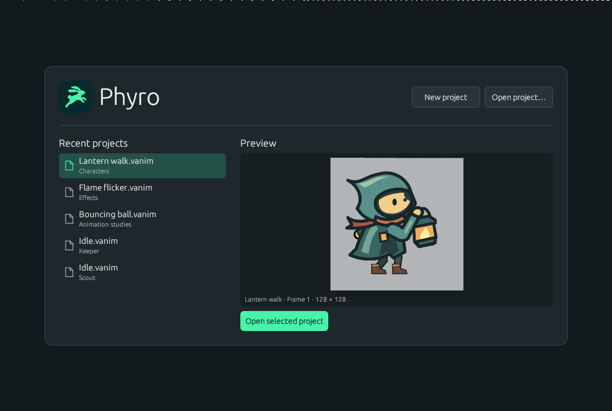
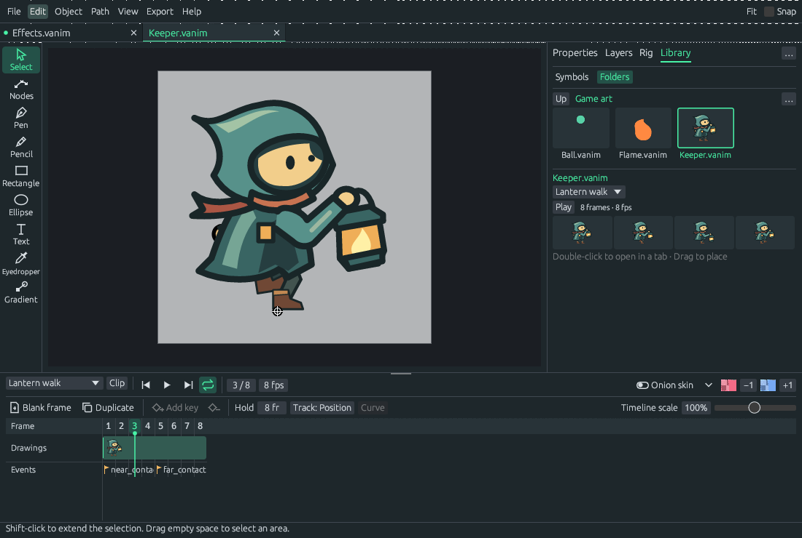
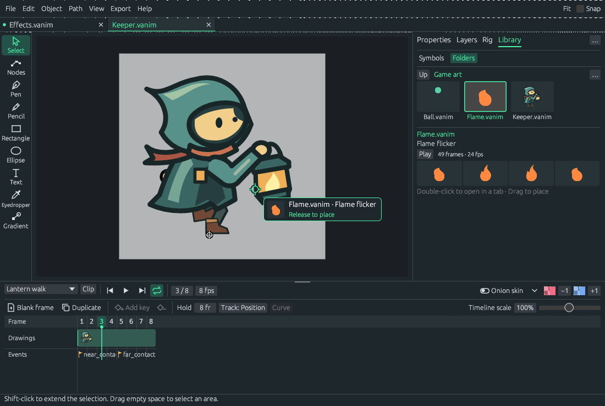
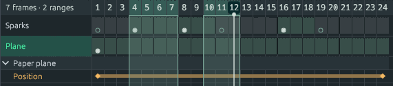
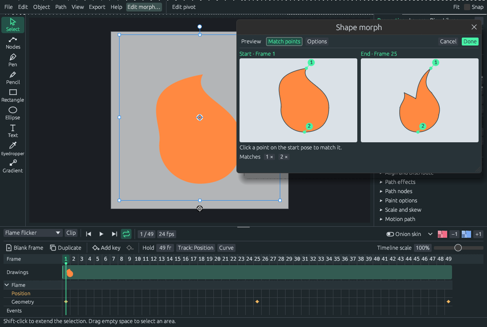

# Phyro editor guide

For a first project, follow [Getting started with Phyro](getting-started.md) to draw, animate and export a sprite. Use this guide for individual editing tasks.

## Review assistant edits

Assistant sharing is off by default. Set up the [local MCP server](command-line.md#connect-an-assistant-to-the-open-editor) and ask your assistant to call `connect`. Select the document you want to share, then choose **File → Share this tab with an assistant…**. Check **Enable assistant sharing**, paste the pairing code and click **Share this tab**. The sharing window names the tab. The assistant can see your unsaved drawings and edits after you finish the current gesture. Switching to another tab pauses access until you return.

For example, select **Sleeve fabric** in Lantern Walk and ask for a copper fill and an eight-pixel move to the right by frame 5. The review shows the same frame of the original and proposed artwork side by side. The fill covers its layer hold. The position key changes the pose at frame 5, with the position track controlling movement between keys. Choose a hold and move **Preview frame** to compare other frames while keeping your working playhead in place.

Click **Apply** to accept the batch. **Undo** restores the whole preceding edit and **Redo** reapplies it. **Reject** discards the proposal. If you edit the artwork during review, your edit takes precedence and the assistant must inspect again. Save the project normally when you want to keep it on disk.

For a live drawing, the preview opens when the first step arrives. Use **Drawing step** to pin an earlier version or **Follow latest** to watch incoming changes. The frame label and Original image refer to the displayed step. **Keep through step N** commits that version in one undoable edit and discards any later steps. **Discard draft** closes the preview. Both controls work while the assistant is still drawing.

Use **Stop sharing** in the toolbar to revoke access and discard the pending review. Closing or replacing the tab also ends sharing. Clear **Enable assistant sharing** to turn off pairing. Phyro remembers the preference and requires a fresh code for every new session. [MCP client setup](command-line.md#connect-an-assistant-to-the-open-editor)

## Open projects and import references

When you launch Phyro, choose **New project** to start with a blank artboard or **Open project…** to browse your files. Selecting a recent project previews the first drawing with artwork in its first clip. The caption gives the clip name, frame number and artboard size. Double-click a recent project to open it.

The desktop download includes sample projects. Drop a `.vanim` file into Phyro and choose **File → Save as…** to keep your own copy.

Each open project has its own tab. Open another project with **File → Open…**, or drop several `.vanim` files together to open the group at once. Click a tab or press **Ctrl+Tab** to move forward and **Ctrl+Shift+Tab** to move back. Returning to a tab restores your zoom, selection, and playhead. Undo applies to the active project.

A dot beside a tab’s name marks unsaved edits. Click its **×** or press **Ctrl+W** to close it. Phyro asks whether to save a changed project, and each edited tab gets its own recovery draft.

To bring in an Inkscape drawing, choose **File → Import SVG as project…**. Paths inside nested groups stay editable and keep their paint order. Each shape belongs to its nearest group in **Layers**. Embedded PNGs and JPEGs stay images, including artwork outside the page. Text imported as glyph outlines can be reshaped with the Nodes tool.

To paste an image from a browser, choose **Copy image** in the browser and press **Ctrl+V** on the Phyro canvas, or choose **Edit → Paste**. The image is selected on the active layer, ready to move or resize. It is embedded in the project and included in exports. To use it for tracing, clear **Include in export** in Properties.

For a tracing image from disk, choose **File → Import Reference Image…** and select a PNG or JPEG. Phyro centers it behind your work on a locked **Reference** layer in the current drawing. Use the eye in Layers to hide it or unlock the layer to reposition it. The reference stays visible through held frames and new blank frames on your drawing layer. It is excluded from exports by default.

## Arrange the workspace

Check **Grayscale** beside **Fit** in the top toolbar or press **Shift+G** to preview the values in your artwork. The same toggle is in the **View** menu. The canvas preview preserves the original paint colors for the color picker, saving and export.

Errors and warnings can appear in a ten-second banner near the top of the window. Choose **Details** to read the full message or **Dismiss** to close the banner. Some export errors appear in the export dialog so you can retry. Open **Help → Recent issues** to review and copy recent messages from this session. The welcome screen also has a **Recent issues** button after an error.

New workspaces show Properties above Layers. In an existing workspace, choose **View → Panels → Layers and Properties together** to see both. Drag the divider to give either one more room. To move a panel to the other side of the canvas or split it into a separate group, open **…** in its tab header and choose a position. Drag a tab onto another tab to group or reorder them. Phyro remembers your layout the next time you open the editor.

Use **Object** for grouping, stacking, alignment, clipping and symbol creation. Right-clicking selected artwork also gives you **Paste style**, **Duplicate** and the most common group and clip commands.

## Set up a drawing grid

Open **View → Panels → Document Properties** and set **Type** to **Axonometric**. The default **X angle** and **Z angle** of 30° give an isometric grid. Adjust each angle to tilt one set of diagonal lines. **Y spacing** sets the distance between intersections along a vertical line. Use **Origin X** and **Origin Y** to position the grid relative to the artboard’s top-left corner. The panel also offers a rectangular grid.

Set **Visibility** to **Always show**, **When snapping** or **Hidden**. Zoom in if the grid lines are too close together to display. Enable **Snap to grid** and turn on **Snap** in the toolbar to place anchors and edits on grid intersections. An eligible anchor, guide or object alignment takes priority over an axonometric intersection. Grid geometry and visibility apply to every clip in the project and are saved in the `.vanim` file. Exports contain only the artwork.

## Browse an asset folder

1. Open **Library → Folders → Choose folder…** and choose your artwork folder. Click a thumbnail to preview it. Double-click a subfolder to browse it, or use **Up** to go up a level. Phyro remembers the folder when you reopen the editor.
2. Select a `.vanim` project to see its clips. For example, select a character, choose its **Run** clip and press **Play** to preview it. Drag its thumbnail or the clip’s filmstrip onto the canvas. When you see **Release to place**, the mint crosshair marks where the center of the clip’s source artboard will land. Larger assets show **Placing…** there while they load. Double-click the Library thumbnail to edit its source in a tab.
3. Click a PNG or JPEG to see its preview below the Library grid. Drag the thumbnail or the preview onto the canvas to place it. You can place an SVG the same way and keep its editable vector artwork. Placing an asset saves a copy inside the scene. You can keep editing the source separately and share the scene without its source folder. **Undo** removes the placement.

Use **… → Refresh folder** after adding or renaming files. Thumbnails for visible files update after you save changes to them. Only the displayed part of the folder needs previews, and Phyro gives drawing and timeline playback priority.

## Draw and reshape a path

To edit the outline of an existing rectangle, ellipse or text object, press **Ctrl+Shift+C** or choose **Path → Convert to path**. You can then reshape it with the Nodes tool. For text, this makes the letter outlines editable. **Undo** restores the original text or shape.

Press **B** for the Bézier Pen. Click for a corner or drag for a smooth node. The Pen and Nodes tools ignore small pointer movements at the start of a handle drag. Hold **Ctrl** to snap the direction from the previous anchor to the nearest **15°** increment. The angle takes priority over grid and guide snapping. To give a curve a sharp turn, drag until the incoming curve looks right, then hold **Shift** while the mouse button is still down. The incoming handle stays in place. Keep dragging to aim the outgoing handle, then release the mouse to place the corner.

While drawing, press **Ctrl+Z** to take back the last node. Repeat to step farther back, then click to continue from the remaining endpoint. **Redo** restores a removed node with its handles until you place a new point. Once you finish the path, **Undo** reverses the completed drawing in one step.

After three nodes, click the start ring to close the path. To shape the closing curve, press the ring and drag in the direction you want the path to travel as it reaches the first node. The curve previews as you drag, and releasing closes the path. The opening segment keeps its shape. Right-click or press **Enter** to finish an open path. The path stays selected so you can change its fill and stroke in **Properties → Appearance**. Click elsewhere with the Pen to start another path using the same paint.

To continue an open path, select it and press **B**. A path you just finished is already selected. Click either endpoint marker and keep drawing. You can also drag the marker to set the tangent for the first new segment. Press **Enter** or right-click to leave the path open, or click its opposite endpoint to close it. **Esc** discards the extension. After finishing, one **Undo** restores the previous path. Endpoint markers appear in **Tracked** and **Manual** key modes on editable paths without geometry keys, skin bindings or live path effects.

For freehand lines, press **P**. Use low **Smoothing** for small details, or raise it toward 200% to steady a shaky stroke. The Pencil fits editable Bézier curves when you lift. Lift when the ring appears near the start to close the shape. Enable **Pressure width** to vary the stroke with a pressure-sensitive tablet.

The initial join style for new paths is **Miter**. Change the join under **Properties → Appearance → Stroke ends and corners**. Very sharp miter corners bevel to prevent long spikes. Pressure strokes use round caps and joins. The Pen, shape tools and Text share a drawing style. The Pencil remembers its own. Phyro restores their fills, strokes, gradients, widths, caps and joins when you reopen the editor. You can select existing artwork to inspect its colors and then return to drawing with your previous style. Open a fill or stroke swatch to reuse one of your eight most recent colors, including its opacity.

SVG export turns a pressure stroke into a filled vector outline. Keep the `.vanim` project if you want to edit the original centerline or pressure profile later.

Press **N** to edit nodes. Double-click a segment to add a node. Click an anchor, **Shift-click** to add individual anchors, or drag a box around several. Hold **Shift** while drawing the box to add to the current selection. **Ctrl-click** a corner anchor to make it symmetric, then **Ctrl-click** again to toggle between symmetric and smooth. Press **Delete** to remove selected nodes. Click **Combine nodes** or press **Shift+J** to merge nodes on one contour into a single anchor at their average position. Combining just the two endpoints of an open path closes it if three or more nodes remain. Deletion must leave at least two anchors on an open path or three on a closed contour. To add or delete nodes directly, use **Tracked** or **Manual** key mode on an unkeyed, unskinned path. Choose **Corner**, **Smooth** or **Symmetric** in the toolbar to change how the selected handles move.

On a selected path, drag between two nodes to bend the segment. Grab the middle for an even bend or closer to one end to give that end more influence. To curve one side of a corner, hold **Ctrl** and drag from the node toward that side to pull out its handle. The node and its opposite handle stay in place. **Shift-drag** from the node to pull out both handles together.

For lettering, press **T**, click and type. Click existing text to edit it in place. Change the font and size in **Properties**, then press **Ctrl+Enter** to finish.

Use **Ctrl+Alt+C** or **Path → Stroke to path** to convert solid and pressure strokes to editable filled outlines. Linear stroke gradients are preserved. Center-out gradients can be converted when their proportions can be preserved. For artwork with both fill and stroke, the fill stays below the new outline. Stroke conversion requires static artwork without clipping or rig bindings.

Select one or more paths and press **Ctrl+L** or choose **Path → Simplify**. Phyro fits straight or smooth Bézier segments across runs of anchors. A gentle turn can gain smooth handles even when its anchor needs to stay. Each fit stays within 0.75 artboard pixels of the curve at the current pose. Open endpoints, sharp turns, and nearby hole boundaries are protected. Press the shortcut again for another pass, or use **Undo** to restore the original paths. Use **Tracked** or **Manual** mode on paths without Geometry keys, skin weights, or live effects.

## Combine and reuse artwork

Use **Properties → Appearance → Object blend** to blend the selected artwork as a whole. **Fill blend** and **Stroke blend** apply to individual paints, including gradients. Use **Layer blend** at the bottom of **Layers** to blend the whole active layer over the layers below it. All controls start at **Normal**.

For a shadow, place a shape above your base color and set its **Fill blend** to **Multiply**. Adjust the fill alpha to control the strength. Paint channels inside a blended object or layer combine there first, then the enclosing blend mode applies to the result. Object and paint modes follow the drawing exposure. Layer mode applies across the clip.

- **Boolean operations.** Press **S** and Shift-click to select shapes. Use **Ctrl + plus** for Union. To cut a hole, place the cutter above the target, select both and press **Ctrl + minus** for Difference. The result stays selected, so Shift-click another cutter to continue. The **Path** menu lists all six operations.
- **Paint.** Click the **Fill** or **Stroke** swatch in Properties. Drag around the ring to choose a hue, then click the triangle to choose its saturation and brightness. The **A** field controls opacity. To sample from the canvas, press **D** and click for fill or Shift-click for stroke. To copy a complete style, copy the source with **Ctrl+C**, select the destinations and press **Ctrl+Shift+V**.
- **No paint.** In **Properties → Appearance**, click **×** beside **Stroke** to remove the outline or beside **Fill** to remove the interior. With one object selected, click **×** again to restore its previous paint, including its gradient and stroke width. A stroke at zero opacity still contributes its width to the selection bounds. Removing the stroke excludes that width. Removing paint applies to the whole drawing exposure. For a solid-color fade, key the paint’s alpha.
- **Gradients.** Open **Fill ▾** for the interior or **Stroke ▾** for the outline. Choose **Linear** for a straight fade, **Radial** for a circular or elliptical fade, or **Rectangular** for a box-shaped fade. Click the gradient preview on either row to edit that paint’s color stops and opacity. Press **G** and choose **Fill** or **Stroke** in the toolbar to show its handles. Drag an endpoint to set the length of the fade. For center-out gradients, drag the square to move the center or a round handle to change its reach.
- **Groups and clips.** Group objects on one layer with **Ctrl+G** and ungroup with **Ctrl+Shift+G**. Double-click the group name in **Layers** to rename it. To crop its artwork, place a path above the group, select both, right-click and choose **Set Clip**. **Release Clip** restores the path. Press **L** to lock selected artwork. Use the lock icons in **Layers** to lock or unlock a layer, group or object.
- **Edit inside a group.** Right-click a group on the canvas and choose **Enter group**. The **Editing group** bar shows the layer and group name, and a dashed mint outline marks the group on the canvas. Click or box-select its members, or use the Nodes tool to edit a path. New drawings and pasted artwork join the group. Click **Exit group**, click the layer name in the bar, or press **Esc** to leave. For a single object, **Ctrl+click** it with the Select tool and press **Ctrl+C** to copy it directly.
- **Transforms.** Drag a corner to scale an object or group. Hold **Ctrl** to scale from its center or **Shift** to keep its proportions. Hold **Ctrl+Shift** to scale proportionally from the center. While dragging artwork, hold **Ctrl** to move horizontally or vertically. Press **H** or **V** to flip horizontally or vertically, including during a move. When drawing a rectangle or ellipse, hold **Shift** for a square or circle and **Ctrl** to draw from the center.
- **Pivot.** With the Select tool (**S**), select one object and drag its crosshair to the point you want to keep fixed. It can sit outside the artwork. For example, drag a sleeve’s pivot to the shoulder, then drag the round handle above the selection to swing the arm. Drag a corner to scale around the same point. Moving the pivot preserves the current pose and can change the arc of an existing animation. **Reset pivot** restores the default. You can also choose **Edit pivot**, click the exact spot, and press **Esc**.
- **Alignment.** Shift-select the items and open **Object → Align and Distribute**. **Biggest selected** keeps the tallest item fixed for horizontal alignment and the widest for vertical alignment. Choose **Largest area** to use the same reference on both axes.
- **Symbols.** Press **Ctrl+Shift+Y** to convert selected artwork to a symbol with an automatic name. To name it yourself, select adjacent artwork on one layer, enter a name under **Library → Symbols** and choose **Convert selection**. Use **Place instance** for linked copies. Change the source with **Edit artwork… → Apply to instances**. Removing a symbol lets you keep its placed copies as independent artwork.

## Combine keyframes and frame-by-frame drawing

The animation set picker filters the clip list. For example, choose **Hero** to see **Idle**, **Run** and **Jump**, then click **Run** to open its playhead and artwork layers. Each clip has its own length, frame rate and drawings. New projects start with one clip in **Animations**. Use **Sets** to rename a set or create another. Removing a set returns its clips to the default set.

Use the **New clip** (+) button beside the clip list to start a blank clip in the current set. It inherits the first clip’s layer layout. Later layer edits apply only to the clip you’re editing. The neighboring buttons duplicate, delete or export the active clip. Open **Clip settings** to rename it, move it to another set or change its sprite origin. Set the clip length in the timeline’s top bar, just before **fps**.

Each named layer has a row in the timeline, with one cell per frame. A filled dot marks the start of a drawing that contains artwork. A hollow dot marks a blank drawing. The following cells hold that drawing until the next start. Click a layer and frame to draw there. **F7** starts a blank drawing on that layer and **Shift+D** copies its drawing. You can also right-click a cell for either action. Drag the boundary between two drawings to change when the second starts. For example, an effects layer can have a new drawing every two frames while the body holds the same drawing for twelve. Select an object on the canvas to see its property tracks beneath its layer. Choose a track and press **K** to key it at the playhead. A continuous amber bar connects key diamonds when the property tweens between them. A Hold keeps its value until the next key. Drag a box from empty space in a keyframe row to select several diamonds, or Ctrl-click diamonds to toggle them individually. Drag the selected keys to move them together or press **Delete** to remove them.

To box-select whole frames, drag across the numbered ruler, the middle of drawing cells, or the empty space below the layers. Hold the pointer near the left or right edge to scroll. Each shaded band marks selected frames across all layers. The label at the left of the ruler shows how many frames are selected.

| Gesture | Frame selection |
| --- | --- |
| Click | Select one frame. |
| Shift-click | Select from the anchor frame to the frame you clicked. A plain click or Ctrl-click sets the anchor. A drag uses the frame where it began. |
| Ctrl-click | Add or remove an individual frame while keeping the others. |
| Ctrl+Shift-click | Add the range from the anchor to the clicked frame. |
| Ctrl-drag | Add another range. |

On macOS, use **⌘** in place of **Ctrl**. **Delete** removes the highlighted frames across all layers. Frames in the gaps keep their order and shift earlier. **Ctrl+Z** restores the whole edit.

Try drawing effects over a moving character or prop with [Draw sparks over motion](../examples/draw-sparks-over-motion.vanim).

1. Open the **Draw FX here** clip and select **Draw sparks here** in **Layers**.
2. Go to frame **12**, press **F7** and draw a spark beside the plane. This starts a fresh drawing on the active layer while the plane’s nested clip keeps playing.
3. Step with **comma** and **period** to compare neighboring frames. Press **O** for onion skins, or **Shift+O** to set how many poses appear before and after the current one. Press **Space** to play at the timeline’s **fps** setting.

For your own shot, animate the moving artwork in a source clip. Create a new clip for the shot, set its length, and select the layer that should hold the moving artwork. Drag the source clip’s name from the timeline onto the artboard where you want its center. In a narrow window, drag its name from the clip dropdown. To use a clip from another set, open the set picker and expand the arrow beside that set, then drag the clip. The parent gets a linked instance on the active layer. Open the source clip to edit the artwork in every instance. Placing a clip from another file through the folder library embeds its source in this project. Add a separate parent layer for hand-drawn effects.

## Morph between two outlines

Open [Guided flame](../examples/guided-flame.vanim), select **Flame** on frame 1 and click **Edit morph…**. It plays from the four-node flame to the seven-node flame. Click **Match points** to see which pairs keep the tip and base together.

1. Draw the two poses in the same held drawing. Use two closed outlines for a silhouette or two open paths for a line. Rectangles and ellipses work directly.
2. Move the playhead to the intended start frame. Press **S**, click the starting shape, then **Shift-click** the end shape and click **Morph** in the toolbar. The preview plays in a window over your drawing. Drag its title bar to uncover part of the canvas, or resize it for a closer look. Pause or scrub to inspect a frame.
3. If a detail drifts, open **Match points**. Click the detail on the start outline and its partner on the end outline. The same number appears on both. You can match points between nodes. Return to **Preview** to see the correction.
4. Click **Done** to apply the morph as one undoable edit. The start shape supplies the paint and gets the **Geometry** keys. Phyro keeps the end shape in **Layers** and hides a static end shape by default. Turn off **Options → Hide end shape** to leave both visible. **Cancel** or the window’s close button discards the preview edits.

The default span is one second where the drawing has room. **Options** lets you change the endpoint frames or swap the two poses. On a new one-frame clip, **Done** extends the clip to fit the morph.

Use a single outline with a uniform-width stroke or fill for each pose. A pressure-width path or a path weighted to bones needs its per-node data for the original layout.

## Pose a character

In **Rig → Skeleton**, choose **Add root bone** and click its two endpoints. With it selected, choose **Add child bone** and click the child’s tip. Select a bone and its artwork, then choose **Bind selection**. At the desired frame, choose **Key pose** and adjust **Pose angle**.

With **Pose handles** enabled, drag the circle at a wrist or ankle to pose both joints. The artwork follows the pointer. Release to key the pose on the current frame, hold **Shift** to reverse the elbow or knee bend, or press **Esc** to cancel.

To plant a foot in [Lantern Walk](../examples/lantern-walk.vanim), select **Near shin**, pose the ankle on its landing frame, and click **Pin foot**. Move the playhead and pose the hips. The ankle holds its position in the rig’s drawing, and the attached sole keeps its angle. On the first frame of toe-off, select the same ankle and click **Release foot**, then drag it into the next pose. If the hips move beyond the leg’s reach, the leg extends toward the pin and keeps its original length.

For a sleeve that bends at the elbow, open [Lantern Elbow](../examples/lantern-elbow.vanim), select **Sleeve fabric** in **Layers** and pick an anchor with **Nodes**. In **Rig → Skeleton**, adjust **Child weight**. At 0% the anchor follows the upper arm, at 100% it follows the forearm. Use **Skin path** to set this up on your own path and child bone.

## Export the current frame

Open **Export** and choose a target under **Current frame**. Each target offers **PNG…**, **SVG…** and **PNG and SVG…**.

| Target | What you get |
| --- | --- |
| Artboard | The visible, exportable artwork at the playhead, framed by the artboard dimensions. |
| Selection | One image cropped around the selected artwork, including artwork outside the artboard. |
| Batch selected objects | One cropped image per selected top-level object or group. Name the objects in **Layers** to set their filenames. |

When exporting PNG, enter **Width**, **Height**, or **Scale**. The dimensions are linked to preserve proportions. For example, set a 1,000 × 1,000 px artboard to **256 px** wide to export a 256 × 256 PNG. For a combined selection, the fields use its visible crop. If the native selection bounds exceed 16 megapixels, Phyro uses the vector bounds so you can still export at a smaller size. For a batch, the artboard sets the common scale and the dialog lists the actual PNG dimensions of each object or group.

Choose a filename for one image or a parent folder for a batch or paired export. Each PNG and SVG pair has the same base name. SVG keeps its size in document units. PNG trims transparent edge pixels and SVG encloses the vector geometry, so a masked shape can have more space around it in SVG.

## Export a moving part

Select the part at a frame where it is visible, then choose **Export → Animated selection…** and set the frame range. All exported frames share one crop and pivot, so the part keeps its motion when played in a game. A selected object follows its layer’s hold through drawings on other layers. To follow it across new drawings on its own layer, give the object and its layer the same unique names in each drawing. A missing object produces a transparent frame. To import a selection sheet with the Godot add-on, copy its `sheet.json` to `animation.phyro` beside `sheet.png`. [Godot playback example](../integrations/godot/README.md#verify-animated-selection-exports)

## Export clips for a game

In the timeline, use **Export set** beside the set picker to export the active set, or **Export clip** beside the clip list to export just the current clip. Both commands are also in the **Export** menu. In a set, tick the clips you want as named animations. Phyro saves those choices in the project. For example, leave **Walk**, **Run** and **Jump** checked in **Hero**, and untick **Boot poses**. The boots still animate inside **Walk**. You can export **Boot poses** directly at any time.

| Output | Export the Hero set | Export just Walk |
| --- | --- | --- |
| PNG sequence per clip | `hero_walk_1.png`, `hero_walk_2.png`, `hero_run_1.png`, … | `hero_walk_1.png`, `hero_walk_2.png`, … |
| Separate sprite sheets | `hero_walk.png`, `hero_run.png`, `hero_jump.png` | `hero_walk.png` |
| Shared sprite sheet | `hero.png` with all checked animations | `hero.png` with Walk only |

Choose a parent folder for the new export. Filenames use the set and clip names, so **Enemy → Walk** gets the prefix `enemy_walk`. Sequences include the full artboard at the chosen resolution and start at **1** for each clip. Set **Frame resolution** for the individual frames. For sheets, **Uniform grid** gives each tick an equally sized cell. Set the columns, padding and margin. **Packed atlas** fits the artwork tightly and lets you trim transparency, share identical frames, rotate regions and extrude edge pixels. **Presets…** loads and saves these settings in the project.

The dialog shows the finished PNG dimensions for the selected layout. **Shared sprite sheet** writes one PNG for the set. **Sprite sheet per clip** writes one PNG for each included clip. If a packed sheet exceeds **Maximum side**, increase the limit (up to 4,096 px), lower the frame resolution, or choose fewer clips. Grid sheets support up to 16 megapixels. A PNG sequence also lets you export each frame individually.

Every layout includes `sheet.json` with the animation names, frame order, FPS, loop settings, pivots and events. To use the bundled Godot importer, copy `animation.phyro` and the PNGs into the same Godot folder. The resulting **SpriteFrames** resource lets you play each animation by name.
