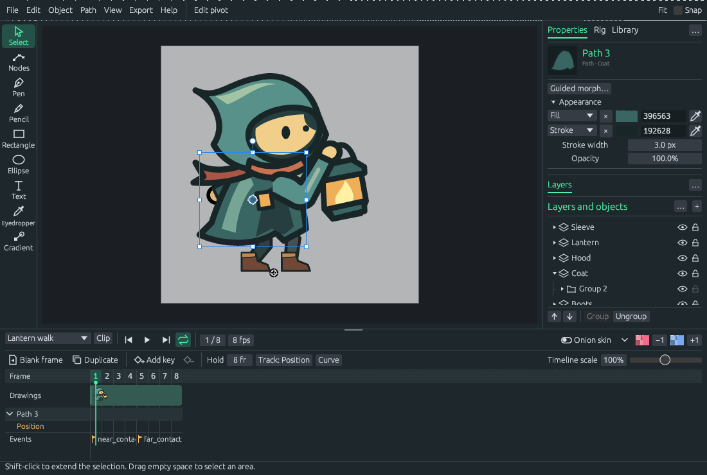
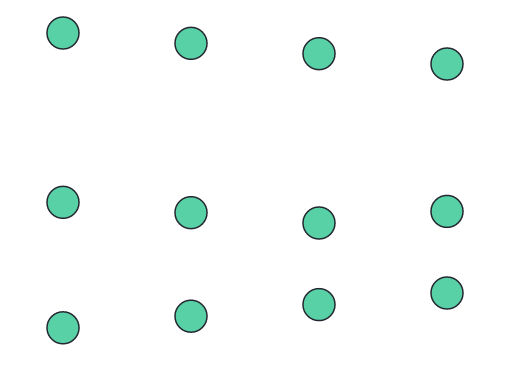

# Getting started with Phyro

Choose **New project** on Phyro’s welcome screen to make a 12-frame bouncing ball, save the editable project, and export a sprite sheet for a game. To try an existing animation first, drop the bundled `lantern-walk.vanim` into Phyro and press **Space**.

## Find your way around

Choose a tool on the left. **Properties** edits the selected artwork. **Layers** lists the objects in drawing order. To see both panels as pictured, choose **View → Panels → Layers and Properties together**. Scroll the mouse wheel to zoom around the pointer, drag with the middle mouse button to pan, and click **Fit** to see the artboard again.

## Draw the ball

1. In the new project, choose **File → Artboard size…**. Set the width and height to **128** and click **Apply**. This gives each exported frame a 128 × 128 pixel tile.
2. In the timeline’s top bar, set the clip length to **12 frames** and the adjacent frame rate to **12 fps**. Click a value to type, then press **Enter**. The clip now lasts one second.
3. Click **frame 1** on the numbered ruler. Press **E** for Ellipse and drag out a small ball near the top of the artboard. Press **S** for Select and click the ball. Click the **Fill** swatch in **Properties → Appearance** to pick a color, then click outside the picker to close it.

## Animate three poses

| Frame | What to do |
| --- | --- |
| **1** | Keep the ball selected. Choose **Position** in the timeline’s **Track** menu and click **Add key** (or press **K**). A diamond marks the starting pose. |
| **7** | Click **7** on the numbered ruler. Press **K**, then drag from inside the ball to move it near the bottom of the artboard. Grab it away from the center crosshair, which moves the pivot. |
| **12** | Click **12** on the ruler. Press **K** and drag the ball back near its starting height. |

Press **Space** to play. The ball travels down and back up as Phyro fills in the positions between your three keys. Press **Space** again to pause. Use **comma** and **period** to step back and forward one frame. To adjust the lowest point, return to frame 7 and move the ball.

The ball stays on one **drawing** throughout this exercise. A **key** records a property of that drawing at a particular frame. For hand-drawn effects, use **Blank frame** (**F7**) on the effects layer to start a fresh drawing at the playhead. [Draw frame-by-frame effects over a moving character](editor-guide.md#combine-keyframes-and-frame-by-frame-drawing)

## Save and export

1. Choose **File → Save as…** and save `bounce.vanim`. Reopen this file when you want to change the ball or its timing.
2. Choose **Export → Export clip…**, then **Sprite sheet per clip**. Under **Frame resolution**, use **100%** for 128 × 128 px frames. Choose **Presets… → Four columns** to arrange them in a uniform grid.
3. With zero padding and margin, the preview shows a single **512 × 384 px** sheet. Click **Export to new folder…** and choose a parent folder. The PNG uses the set and clip names. The accompanying `sheet.json` describes the twelve tiles and their timing.

To compare your keys with the finished exercise, open [Bouncing ball](../examples/bouncing-ball.vanim), click the ball, and look at its **Position** track.

For a character animated over a larger background, select the character and use **Export → Animated selection…**. The exported frames share a crop and pivot so the character keeps its motion. [Export a moving part](editor-guide.md#export-a-moving-part)

## Keep drawing

- [Draw and edit Bézier paths, freehand strokes and text](editor-guide.md#draw-and-reshape-a-path)
- [Use Boolean operations, gradients, clipping and symbols](editor-guide.md#combine-and-reuse-artwork)
- [Morph between two shapes and match points](editor-guide.md#morph-between-two-outlines)
- [Pose a character and pin a foot](editor-guide.md#pose-a-character)
- [Inspect, edit and export with the command line](command-line.md)

To find or change a shortcut, open **Edit → Keyboard shortcuts…**. If a session is interrupted, open **File → Recover drafts…**, recover a copy, and use **Save as…** to keep it.
